# CX Notes — Ръководство на потребителя

Ръководството описва интерфейса на **CX Notes** (приложението в папка `uni/` на репото `cepreu5/SeeNotes`): какво прави всеки бутон, всеки ред в Настройки и всяка скрита от пръв поглед функция. Снимките са правени в **демо режим** (`?demo=1`) в реален браузър, на 1280×900 и на 390×844.

Демото е пълнофункционално с едно изключение: не прави заявки към Google, затова бележките живеят само в браузъра на устройството.

---

## 1. Стартов екран и вход

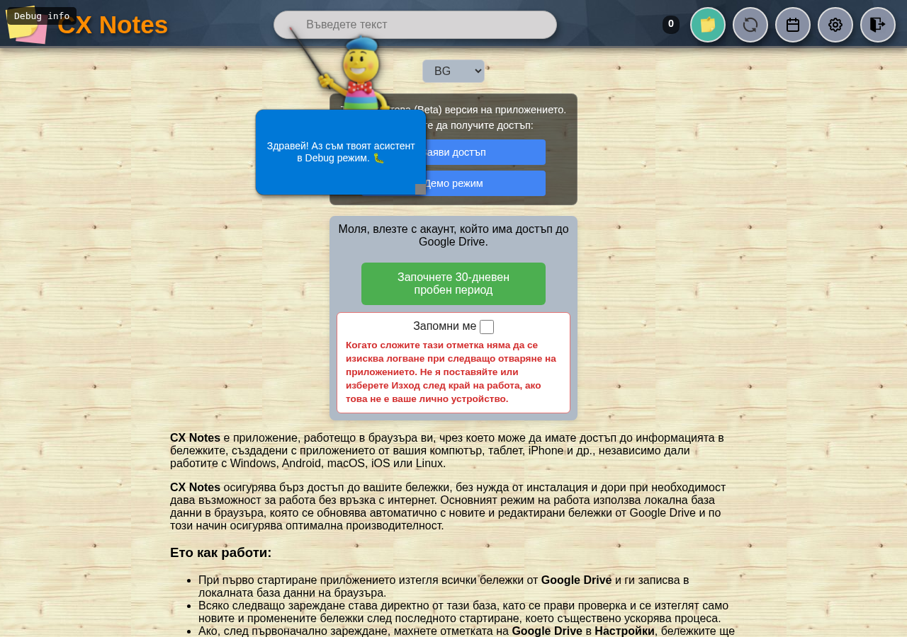

- **Вход** — влизане с Google акаунт, който има достъп до Google Drive.
- **Запомни ме** — след отметка не се иска вход при следващо отваряне. Не се слага на чуждо устройство; там се ползва **Изход**.
- **Демо режим** — влиза без акаунт, с празна собствена база. Първо пита с попъпа на приложението, после отваря приложението с лента „Демо режим“ под хедъра.
- **Заяви достъп** — отваря форма (имейл, име, държава), която подготвя текст за копиране и изпращане до `cx.notes.web@gmail.com`.
- **Пробен период** — 30-дневен пробен период за нов профил.
- Ако няма мрежа, приложението предлага **Старт офлайн** и работи от вече изтеглените данни.

---

## 2. Главният екран

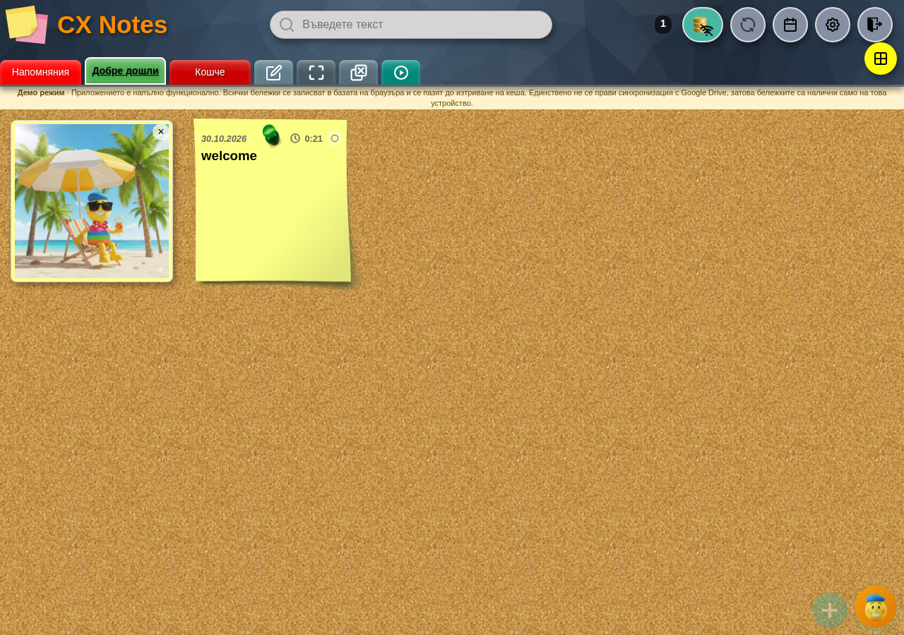

Екранът е коркова дъска, върху която бележките на избрания борд стоят като листчета. Горе е хедърът, под него — лентата с бордовете, долу вдясно — кръглите бутони за нова бележка (**+**) и за асистента (Лепчо).

### Хедър

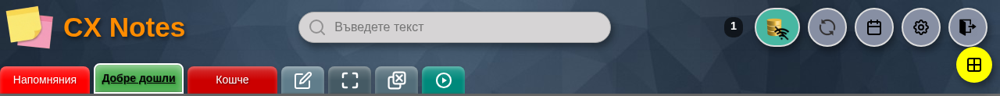

Отляво надясно:

| Елемент | Какво прави |
|---|---|
| **Лого и „CX Notes“** | Начало; при скрит хедър (цял екран) се връща с квадратчето за цял екран. |
| **Поле за търсене** | Търси в активния борд или навсякъде (виж §5). |
| **Брояч на бележките** | Показва колко бележки има в изгледа; клик отваря системните данни (същото като командата `/2`). |
| **Режим** (иконата с бележката) | Виж §10 — това е най-неочевидният бутон в приложението. |
| **Презареди** | Презарежда страницата. С **Ctrl+клик** или **Shift+клик** пуска принудителна синхронизация (пълно презареждане на данните). |
| **Календар** | Отваря месечния календар (§6). Когато звънчето е активно, кликът отваря бележката на събитието, а не филтъра. |
| **Настройки** | Отваря Настройки (§11). |
| **Изход** | Изход от профила; в демо режим излиза от демото. |
| **Инсталирай** | Появява се само когато браузърът позволи инсталиране като приложение (PWA). |

### Лентата с бордовете

Под хедъра са плочките на бордовете: **Напомняния**, самите бордове (в примера „Добре дошли“), **Кошче**, а най-вдясно — четири служебни квадратчета:

- **✎ Нареди** — отваря прозореца за нов/редакция на борд и за подредба на бордовете.
- **⛶ Цял екран** — скрива хедъра, за да остане повече място за бележките; същият бутон ги връща.
- **⊟ Затвори всички бележки** — затваря всички отворени прозорци; пита, ако има незаписани промени.
- **▶ Тур** — пуска обиколката с асистента отначало.

**Ctrl+клик върху която и да е плочка** отваря менюто с всички бордове и служебните квадратчета на едно място (`08-boards-menu.png`, §9).

Допълнителни бордове — **Всички**, **Със снимки**, **С видео**, **Със звук**, **Други приложения**, **Нови** — се включват от Настройки (§11) и се появяват в лентата.

### Бележка на борда

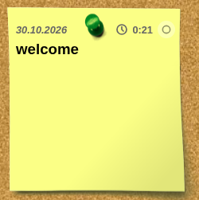

- **Дата и час** горе вляво; датата може да е дата на промяна или дата от календара (задава се в Настройки).
- **Зелената точка** отбелязва бележка, свързана със събитие.
- **Кръгчето за закачане** (вдясно от часа) закача бележката най-отпред в борда.
- **Заглавие** и **съдържание**; дълга бележка се скролва вътре в картата.
- **Футърът** (празното под текста) отваря бележката — удобно на телефон, без да се цели текстът.
- **Плочки на прикачени файлове** — снимка, видео, звук или друг файл; плочката отваря преглед.
- **Плъзгане на карта** мести бележката на друго място в борда (собствена подредба).
- **Клик** отваря бележката, **Shift+клик** я добавя към избраните (§8).

### Лента на отворените бележки

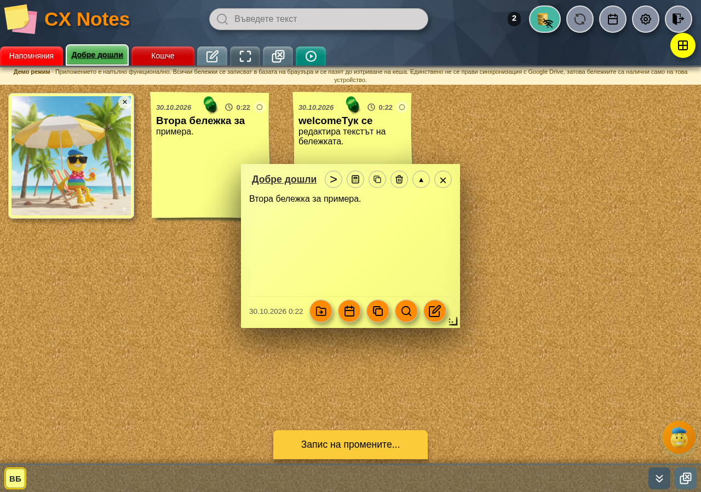

Когато са отворени две или повече бележки, долу вляво се появява лента с плочки от по три букви (първите две думи на заглавието). Плочката връща бележката напред; скритите бележки също държат лентата видима. При една отворена бележка лентата не се показва.

---

## 3. Прозорец на бележка

Отваря се с клик върху картата и показва бележката в режим **Преглед**.

Горен ред, отляво надясно: заглавие и икони **<** предишна, **>** следваща бележка, **изчисли израз**, **копирай съдържанието**, **постави от клипборда**, **изтрий бележката**, **максимизирай** (▲) и **затвори** (×).

Долен ред: дата и час и кръгли бутони **премести в борд**, **календар**, **копирай бележката**, **търсене в бележката**, **редактирай**. В долния десен ъгъл има дръжка за преоразмеряване: влаченето задава размера на *новите* бележки, а **Ctrl+влачене** (на телефон — задържане) променя размера само на тази бележка.

Всяка бележка се отваря в свой прозорец; няколко могат да стоят отворени едновременно и да се местят свободно по дъската. **Закачането** (кръгчето на картата) държи бележката най-отпред.

## 4. Режим „Редактиране“

Отваря се с **редактирай** (моливчето) или с **Ctrl+клик** върху текста на бележката. Изисква включена база или активна синхронизация с Google Drive.

Лента с инструменти: **↶ / ↷** отмяна и повторение, **B**, *I*, <u>U</u>, ~~S~~, **списък с маркери**, **номериран списък**, **← / →** за един знак наляво/надясно (с **Ctrl** или задържане — начало/край на реда, повторно — начало/край на целия текст), **▦ подравни таблицата** под курсора (второ натискане я връща компактна; с **Ctrl/⌘+клик** — всички таблици).

Долен ред: **прикачи файл**, **запис**, **преглед**, **търсене в бележката**. „Запис“ пише в базата и, ако е включено, в Google Drive и в локалната папка; тостът казва къде точно е записана бележката.

Клавиши в редактора: **Ctrl+Z** отмяна, **Ctrl+Shift+Z** или **Ctrl+Y** повторение, **Ctrl+B / I / U / D** удебелен, курсив, подчертан, задраскан.

Символите за markdown (удебелен, курсив, задраскан, подчертан, изчистване, булет) се сменят от Настройки → **Markdown символи**.

## 5. Търсене

Полето горе търси текст. Клик върху иконата в полето сменя обхвата: **търсене в активния борд** ↔ **търсене навсякъде**.

- **Enter** прилага търсенето и показва списъка със запазени търсения; колко се пазят се задава в Настройки (по подразбиране 20).
- **Ctrl+клик** върху плочка на борд отваря менюто с бордове (§9).

Команди — пишат се в полето и се потвърждават с **Enter**:

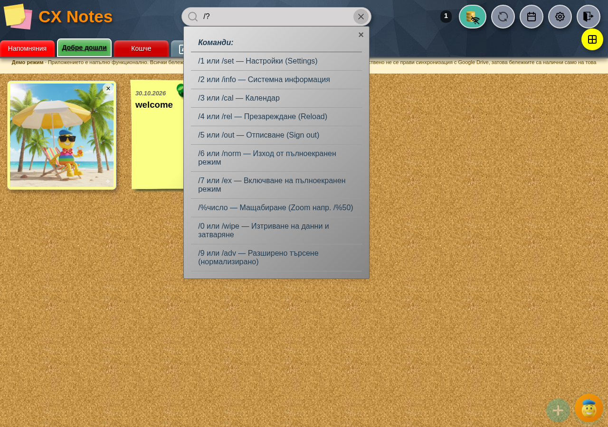

| Команда | Действие |
|---|---|
| `/1`, `/set`, `/settings` | Настройки |
| `/2`, `/info` | Системна информация |
| `/3`, `/cal` | Календар |
| `/4`, `/rel` | Презареждане |
| `/5`, `/out` | Изход |
| `/6`, `/norm` | Изход от цял екран |
| `/7`, `/ex` | Цял екран |
| `/%50` | Мащаб 50% |
| `/9`, `/adv` | Разширено (нормализирано) търсене — остава като режим в полето |
| `/0`, `/wipe` | Изтрива всички данни след въведен код за потвърждение |
| `/?`, `/help` | Списък с командите |

## 6. Календар

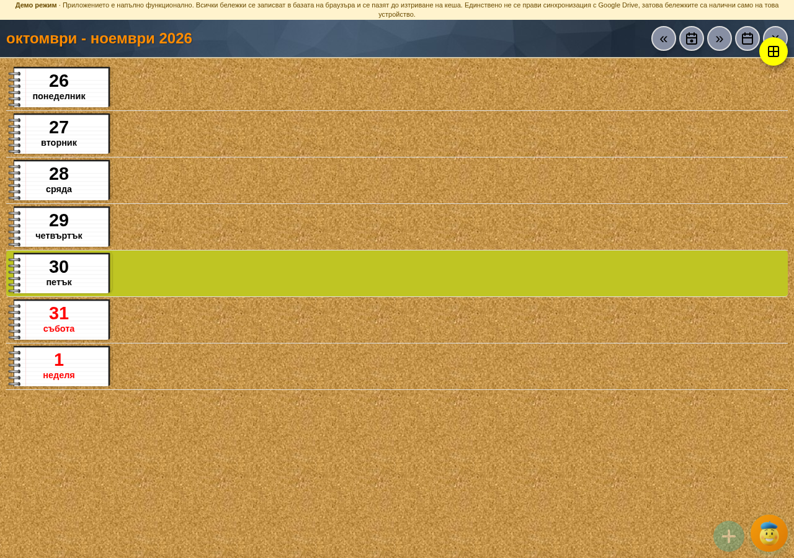

Месечен изглед с **Днес**, стрелки за предишен/следващ месец и превключване **месечен ↔ седмичен** (седмичният се включва и от Настройки). Ден с бележки носи точка; кликът върху деня филтрира бележките за тази дата.

Ако е включено **Запис в Google Календар**, бележките с дата се записват като събития в отделен календар „CX Notes“, а звънчето в хедъра отваря бележката на наближаващо събитие.

## 7. Кошче

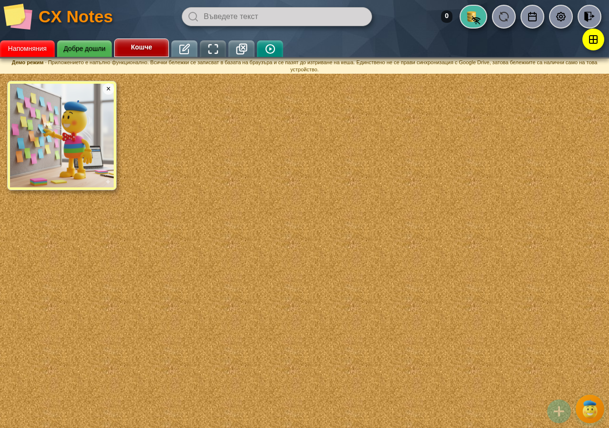

Плочката **Кошче** показва изтритите бележки. Там има търсене (включва се от Настройки), **възстанови бележката** и бутон за **изпразване на кошчето** — той трие и бордовете, които са останали само в кошчето, но пази последния борд, защото приложението не работи без борд. Изпразването пита с точния брой бележки и имената на бордовете.

## 8. Масов избор на бележки

- **Shift+клик** добавя бележка към избраните, **Ctrl/Cmd+A** избира всички видими, **Escape** изчиства избора.
- Появява се лента с броя избрани и действия **Премести**, **Изтрий** (в кошчето — **Изтрий окончателно**), **Изчисти избора**.
- След действие се предлага **Отмени**.

## 9. Бордове: нов, редакция, подредба

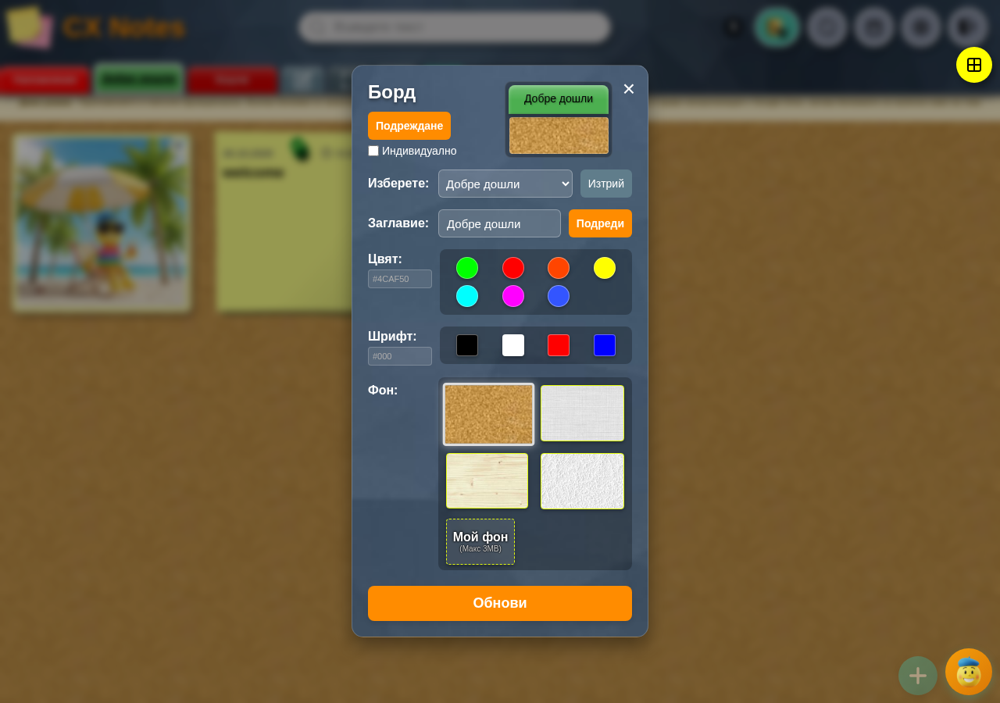

Квадратчето **✎ Нареди** отваря прозореца за борд: избор на борд за редакция, **Изтрий**, **Заглавие**, **Цвят**, **Шрифт**, **Фон** (включително собствена картинка до 3 MB), **Подреди** и превключвател за индивидуална подредба на бележките. Празно заглавие не се приема, както и повторено име.

Менюто с всички бордове показва плочките в една мрежа — удобно на телефон, когато лентата не се събира.

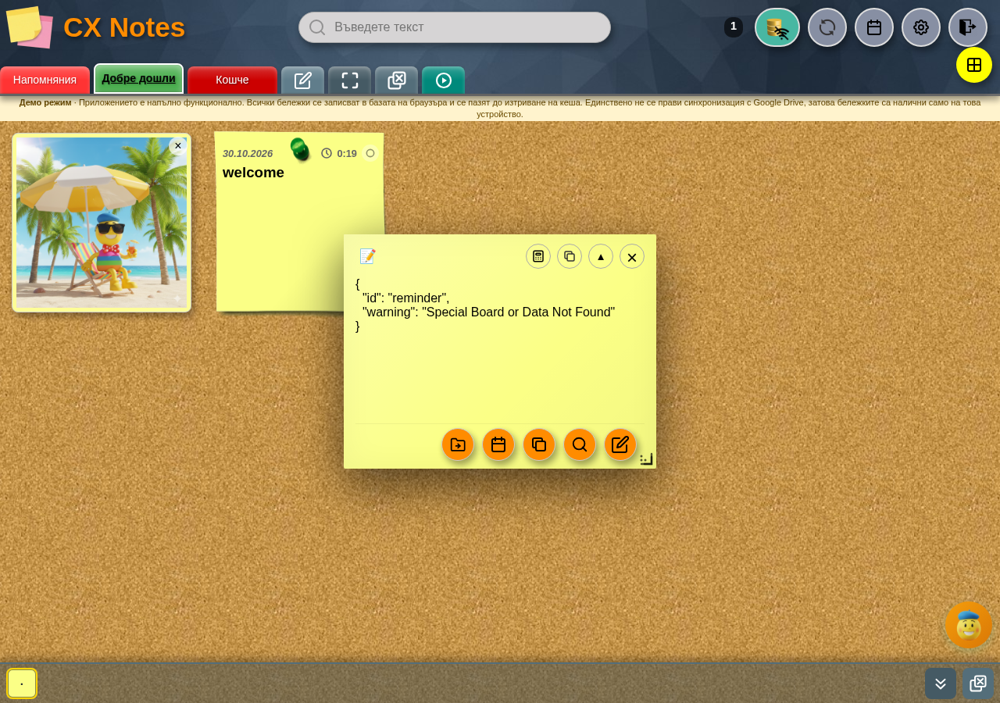

---

## 10. Бутонът „Режим“ — какво прави всъщност

Това е най-неочевидният бутон. Иконата му показва режима на данните (бележка, база, диск, папка, архив), а кликът прави едно от три неща, по ред:

1. **Ако синхронизацията е спряна** (има предупредителен знак): иска вход отново, защото без токен синхронизация не може да тръгне. Знакът се маха чак когато токенът наистина дойде — отказан вход не оставя приложението в „уж онлайн“ състояние.
2. **Ако приложението е офлайн**: проверява дали мрежата наистина я има (заявка към Google и, ако тя не мине, към собствената страница). При успех маха `?offline` от адреса, показва „Възстановен е онлайн режим“ и стартира онлайн. При неуспех казва, че синхронизацията е невъзможна.
3. **Иначе**: ако работиш **само с база** (Google Drive, локална папка и архив са изключени) и базата съществува — пуска синхронизация. Във всички останали случаи отваря **Настройки**, за да смениш източника.

Режимите, които редът „Режим“ може да показва: **База данни + Google Drive**, **База данни + Локална папка**, **База данни + Архив**, **Google Drive**, **База данни**. Същите се избират от Настройки → **Четене на данни** и **Разширени настройки**.

## 11. Настройки

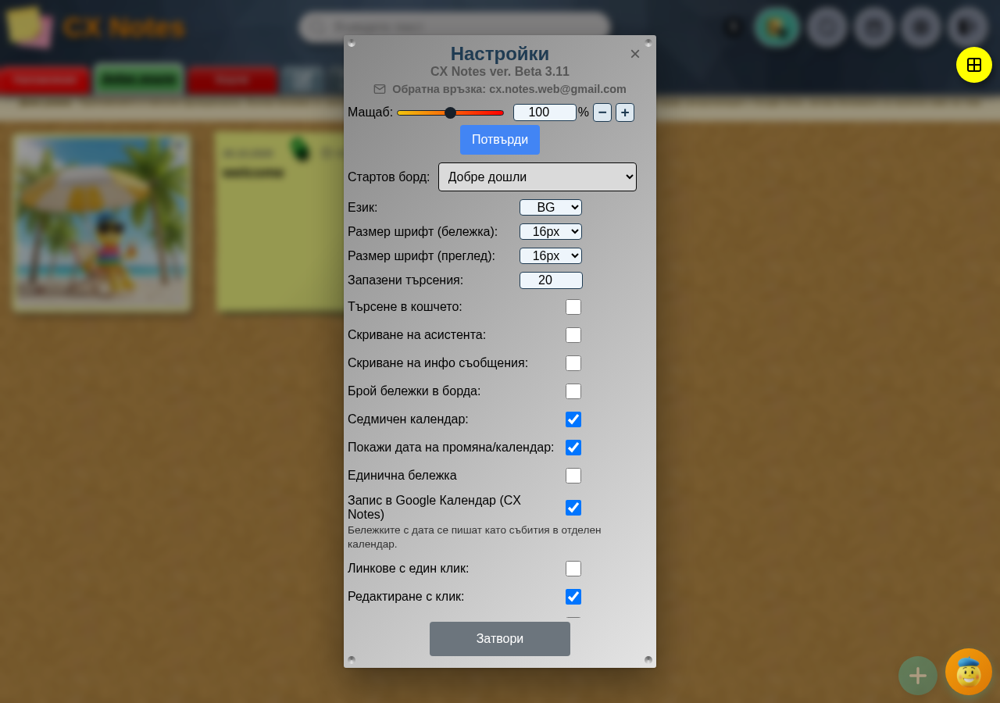

Отгоре е редът с версията — **„CX Notes ver. …“**. Той е и скрит бутон: **Ctrl+клик** върху него (или задържане три секунди) показва/скрива **Разширените настройки**. Ако приложението не може да разчете версията от service worker-а (`CACHE_NAME` във `sw.js` от вида `cx-notes-b…`), редът се скрива изцяло.

Редове в основната част:

- **Мащаб** — плъзгач, число в проценти и стъпки −/+; **Потвърди** прилага мащаба. Същото като `/%число`.
- **Стартов борд** — кой борд се отваря при стартиране.
- **Език** — BG / EN.
- **Размер шрифт (бележка)** и **Размер шрифт (преглед)** — за картата на борда и за прозореца на бележката.
- **Запазени търсения** — колко да се пазят.
- **Търсене в кошчето** — включва поле за търсене и в Кошчето.
- **Скриване на асистента** — маха кръглия бутон на Лепчо.
- **Скриване на инфо съобщения** — спира тостовете.
- **Брой бележки в борда** — показва числото върху плочката на борда.
- **Седмичен календар** — добавя седмичния изглед.
- **Покажи дата на промяна/календар** — каква дата носи картата.
- **Единична бележка** — отваря се по една бележка, вместо няколко прозореца.
- **Запис в Google Календар (CX Notes)** — бележките с дата стават събития; под реда се показва състоянието на връзката.
- **Линкове с един клик** — отваря връзките с едно натискане.
- **Редактиране с клик** — кликът в бележката влиза направо в редактора, без преглед.
- **Затваряне след запис** — затваря прозореца след „Запис“.
- **Автоматично напомняне** — автоматично напомняне за бележки с дата.
- **Графичен фон (бележки в борда)** и **Графичен фон (бележка)** — снимка вместо цвят.
- **Покажи допълнителни бордове** — плочки за **Напомняния**, **Всички**, **Със снимки**, **С видео**, **Със звук**, **Други приложения**, **Нови**.
- **Подреждане на бележките** — по номер, по цвят, по дата на създаване, по дата на промяна, по дата в календара, по азбучен ред; плюс **в обратен ред** и **напомняния най-отгоре**; отделно подреждане за системен борд.
- **Четене на данни** — **Google Drive** и **База данни** с бутони **Създай** и **Изтрий** за локалната база.
- **Профил** — няколко профила: **+** нов, **−** изтрий текущия, **Зареждане**, **Запис**.
- **Разширени настройки** (виж по-долу).

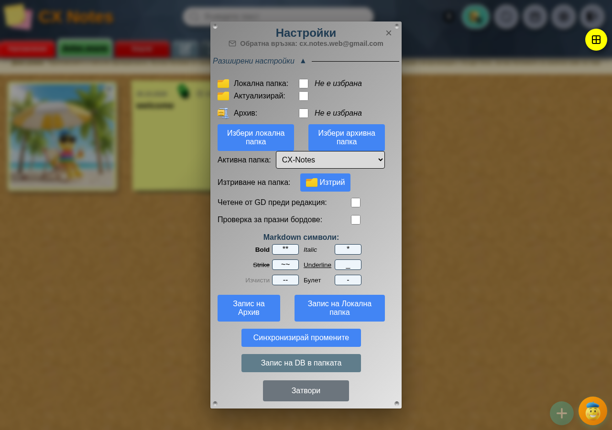

В разширените: **Локална папка** (и **Обнови**), **Архив**, избор на папки, **Активна папка** (включително нова папка в Google Drive), **Изтриване на папка** (с изпразване на съдържанието), **Четене от GD преди редакция** и **Проверка за празни бордове**.

Още в същата секция:

- **Markdown символи** — собствени знаци за удебелен, курсив, задраскан, подчертан, изчистване и булет.
- **Запис на Архив**, **Запис на Локална папка**, **Синхронизирай промените**, **Запис на DB в папката** — ръчни записи по източници (пазят се предпазни проверки, напр. „Папката не е празна“).
- **Системни данни** — потребител, последни синхронизации, време за зареждане, източник и собственик на базата, връзки към приложенията.
- **Затвори**.

## 12. Асистентът Лепчо

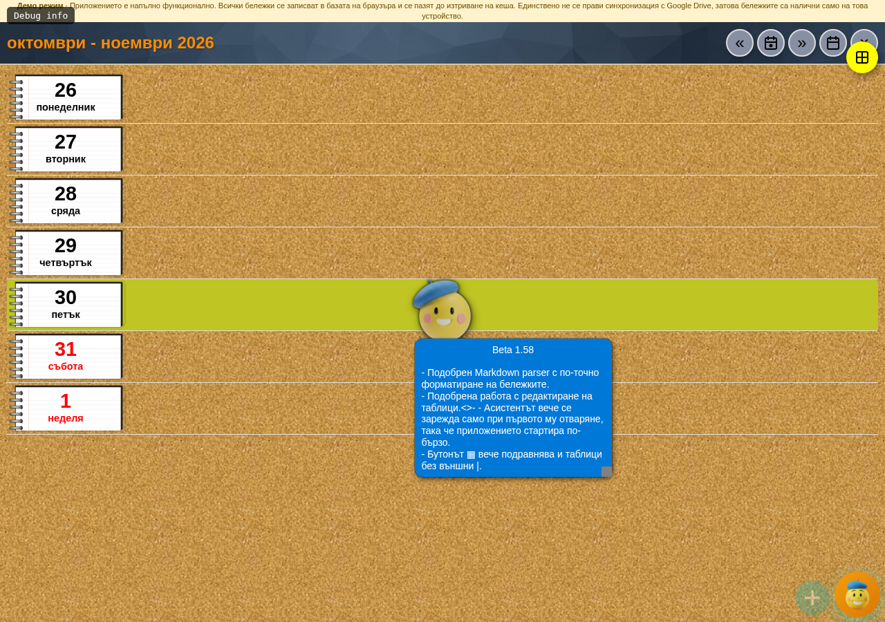

Кръглият бутон долу вдясно отваря чат с асистента: питаш с думи, той отговаря от базата със знания на приложението и може да изпълни действие (отваряне на настройка, настройка на ред и др.). В заглавната му лента: **↻** презарежда базата със знания, **📑** всички въпроси, **−** минимизира; долу — изчистване и изпращане. С **Ctrl+клик** (на телефон — задържане половин секунда) върху кръглия бутон той става полупрозрачен и не закрива дъската; повторно го връща.

Квадратчето **▶** в лентата с бордовете пуска обиколката отначало; при обиколка върху екрана се появява маска с указания. Затваря се при отваряне на Настройки или с отказа от обиколката.

## 13. Цял екран

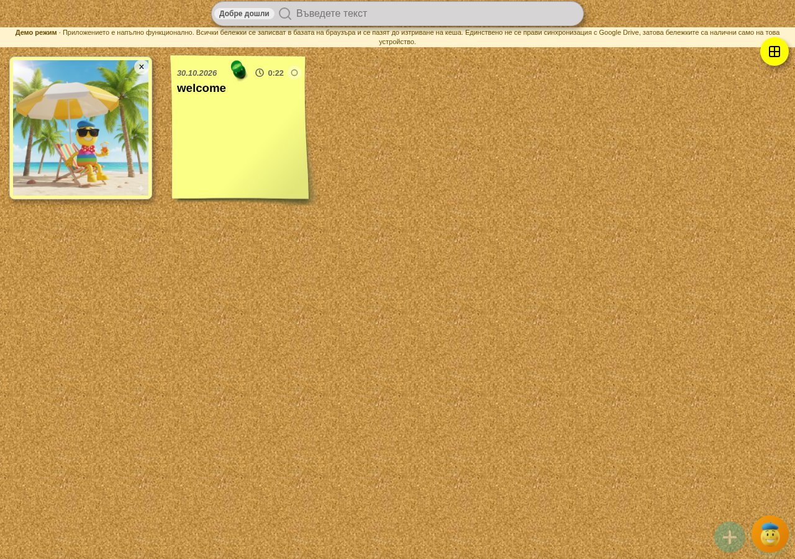

Квадратчето **⛶** скрива хедъра и лентата, за да остане само дъската; същият бутон връща хедъра. Командите `/7` и `/6` правят същото. Същото прави и **Ctrl+клик** върху плаващото квадратче с иконата на бордовете — сменя режима, без да отваря менюто.

## 14. Телефон

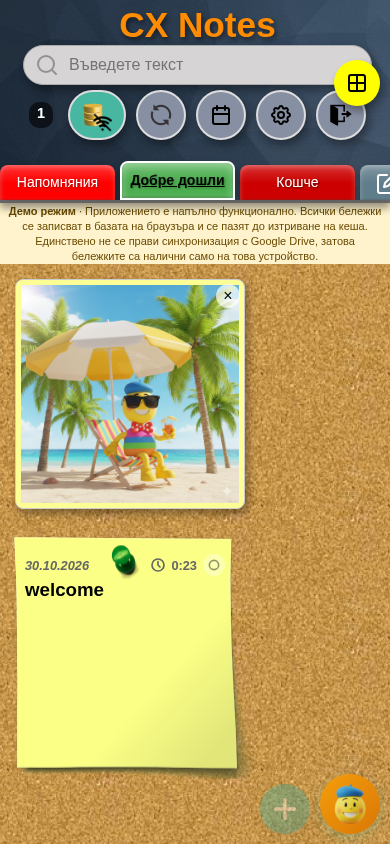

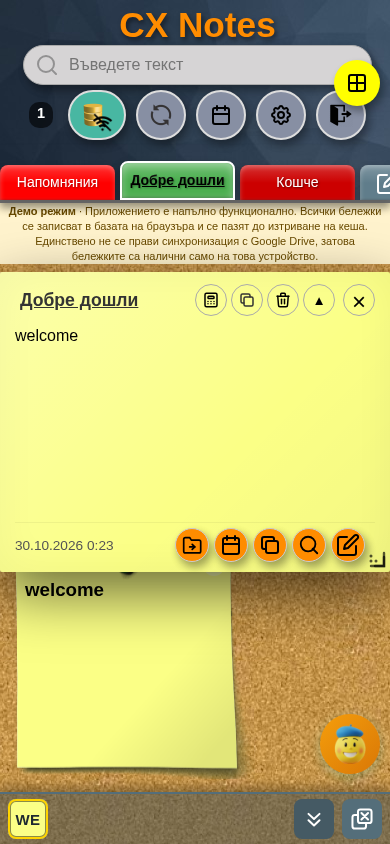

На тясен екран хедърът се сгъва, лентата с бордовете се скролва настрани, а прозорецът на бележката заема почти целия екран. Задържането с пръст замества **Ctrl** при преоразмеряване на бележка. Приложението може да се инсталира на началния екран и да работи на цял екран.

## 15. Скрити и малко известни функции

- **Клик в празното на горната ивица на картата** отваря JSON-а на бележката — полезно при диагностика.
- **Ctrl+клик върху плочка на прикачен файл** показва JSON записа на файла.
- **Ctrl+клик върху текст в бележката** влиза в редактора (когато е включена база или синхронизация).
- **Ctrl+клик върху борд** — менюто с всички бордове.
- **Ctrl+клик върху „Презареди“** — принудителна синхронизация.
- **Ctrl+клик или задържане върху реда с версията** — Разширени настройки.
- **Ctrl+клик върху „▦“** — подравнява всички таблици, не само тази под курсора.
- **Стрелките ← →** в редактора: с **Ctrl** (или задържане) отиват в началото/края на реда, повторно — на целия текст.
- **Ctrl+A** избира всички бележки в изгледа; **Escape** изчиства избора.
- **Плъзгане на карта** мести бележката в борда; **плъзгане на борд** в режим „Нареди“ подрежда бордовете.
- **Дръжката в долния десен ъгъл на бележката** задава размера на новите бележки; с **Ctrl** — само на тази.
- **Командите в полето за търсене** (`/?` за списъка).
- **Ctrl+клик върху „+“** — нов борд, вместо нова бележка.
- **Ctrl+клик (или задържане) върху „изчисли израз“** в бележка — смята само редовете, отбелязани с **☑**.
- **Ctrl+клик върху плъзгача за мащаб** в Настройки — мести стойността до следващото кръгло число (10, 20, 30 …).
- **Ctrl+клик върху заглавието на бележка** в борда — изтрива я; пита за потвърждение и я праща в Кошчето.
- **Ctrl+клик (или задържане) върху кръглия бутон на Лепчо** — прави го полупрозрачен.
- **Ctrl+клик върху плаващото квадратче с бордовете** — цял екран, без да отваря менюто.
- **Демо режим** — `?demo=1` в адреса; `?demo=0` го изключва.
- **Офлайн старт** — при липса на мрежа приложението предлага работа от вече заредените данни.

## 16. Демо режим

Демото не прави заявки към интернет: бележките се пазят в базата на браузъра до изтриване на кеша и са налични само на това устройство. Лентата под хедъра го напомня, а изходът е бутонът **Изход** в хедъра.

## 17. Известни особености

- **Редът с версията** в Настройки се показва само ако името на кеша във `sw.js` е от вида `cx-notes-b…`; при друго име редът се скрива, а заедно с него и жестът за Разширени настройки (остава **Ctrl+клик** върху заглавието на секцията „Разширени настройки“, която се вижда, когато е отворена).
- **„Debug info“** в горния ляв ъгъл е надпис от обиколката на асистента и изчезва, когато обиколката приключи.

---

*Ръководството е съставено по кода на `uni/main.js`, `uni/index.html` и `uni/lang/i18n-bg.json`; снимките са от истински браузър в демо режим, 30 октомври 2026.*

