# CX Notes — User Manual

This manual describes the interface of **CX Notes** (the app in the `uni/` folder of `cepreu5/SeeNotes`): what every button does, every row in Settings, and the functions that are not obvious at first glance. The screenshots were taken in **demo mode** (`?demo=1`) in a real browser, at 1280×900 and at 390×844.

Demo mode is fully functional with one exception: it makes no requests to Google, so the notes stay in the browser on that device only.

---

## 1. Start screen and sign-in

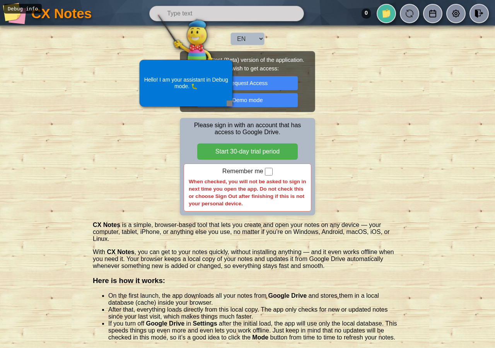

- **Sign in** — sign in with a Google account that has access to Google Drive.
- **Remember me** — with this ticked the app does not ask for sign-in next time. Do not tick it on a shared device; use **Sign out** there instead.
- **Demo mode** — enters without an account, with its own empty database. It asks first with the app's own popup, then opens the app with a "Demo mode" strip under the header.
- **Request access** — opens a form (email, name, country) that prepares a text to copy and send to `cx.notes.web@gmail.com`.
- **Trial** — a 30-day trial period for a new profile.
- With no network, the app offers **Start offline** and works from the data already downloaded.

---

## 2. The main screen

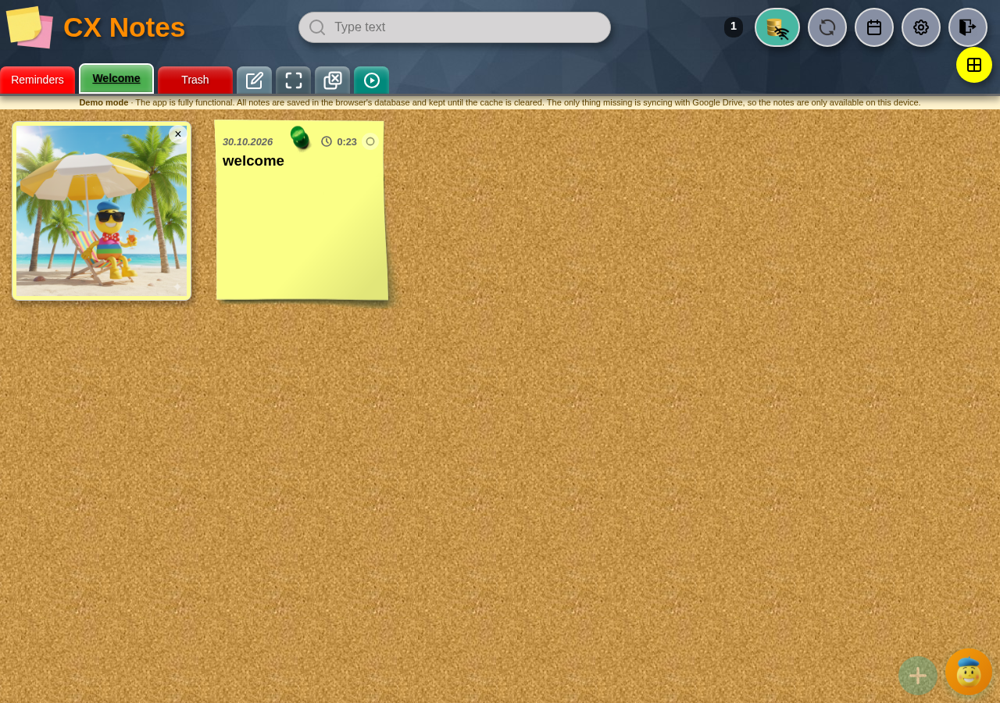

The screen is a cork board, and the notes of the selected board sit on it as slips of paper. At the top is the header, under it the board bar, and in the bottom right corner the round buttons for a new note (**+**) and for the assistant (Лепчо).

### Header

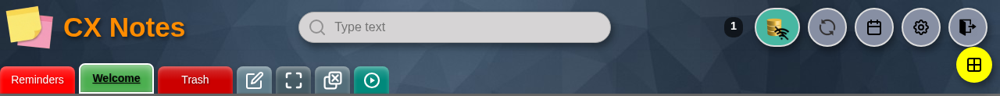

From left to right:

| Element | What it does |
|---|---|
| **Logo and "CX Notes"** | Home; when the header is hidden (full screen) it comes back with the full-screen square. |
| **Search field** | Searches the active board or everywhere (see §5). |
| **Note counter** | Shows how many notes are in the view; a click shows system data (the same as `/2`). |
| **Mode** (the note icon) | See §10 — this is the least obvious button in the app. |
| **Reload** | Reloads the page. With **Ctrl+click** or **Shift+click** it forces a full re-sync of the data. |
| **Calendar** | Opens the monthly calendar (§6). While the bell is active, the click opens the event's note instead of the filter. |
| **Settings** | Opens Settings (§11). |
| **Sign out** | Signs out; in demo mode it leaves the demo. |
| **Install** | Appears only when the browser allows installing the app (PWA). |

### The board bar

Under the header are the board tiles: **Reminders**, the boards themselves ("Welcome" in the example), **Trash**, and on the far right four utility squares:

- **✎ Reorder** — opens the window for a new/edited board and for reordering boards.
- **⛶ Full screen** — hides the header to leave more room for the notes; the same button brings it back.
- **⊟ Close all notes** — closes every open note window, asking first if there are unsaved changes.
- **▶ Tour** — restarts the assistant's guided tour.

**Ctrl+click on any tile** opens the menu with all boards and the utility squares in one place (`08-boards-menu.png`, §9).

Extra boards — **All**, **With photos**, **With video**, **With sound**, **Other apps**, **New** — are switched on in Settings (§11) and then appear in the bar.

### A note on the board

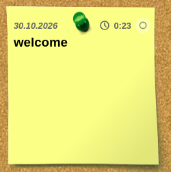

- **Date and time** at the top left; the date can be the modification date or the calendar date (set in Settings).
- **The green dot** marks a note tied to a calendar event.
- **The pin circle** (right of the time) keeps the note at the front of the board.
- **Title** and **content**; a long note scrolls inside the card.
- **The footer** (the empty space under the text) opens the note — handy on a phone, where you do not have to aim at the text.
- **Attachment tiles** — photo, video, sound or another file; the tile opens a preview.
- **Dragging a card** moves the note elsewhere in the board (custom order).
- **Click** opens the note, **Shift+click** adds it to the selection (§8).

### The open notes bar

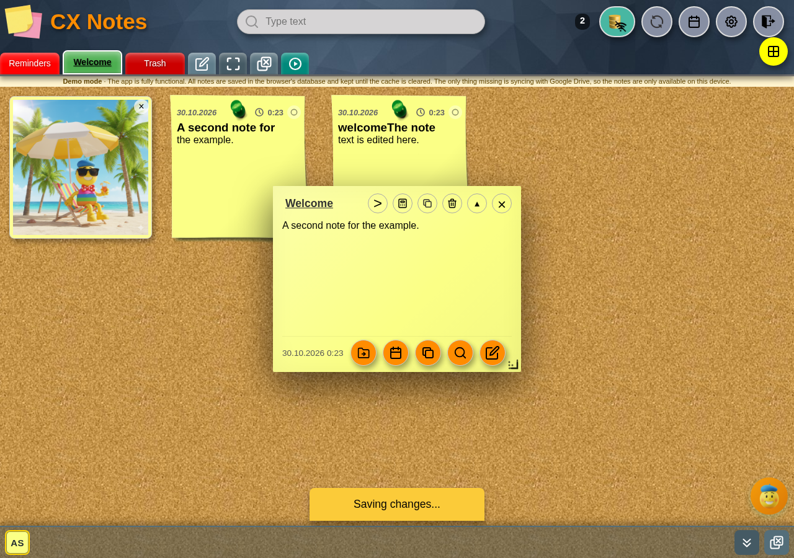

When two or more notes are open, a bar appears at the bottom left with tiles of three letters each (the first two words of the title). A tile brings its note forward; hidden notes keep the bar visible too. With a single open note the bar does not show.

---

## 3. The note window

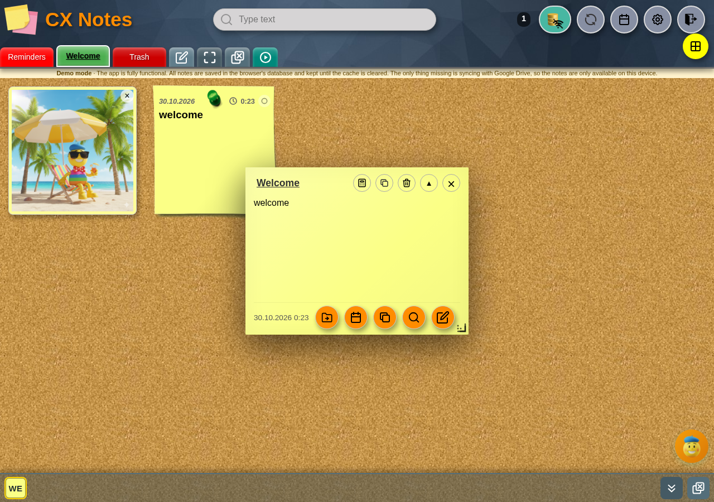

Opens with a click on a card and shows the note in **Preview** mode.

Top row, left to right: the title and the icons **<** previous note, **>** next note, **calculate expression**, **copy content**, **paste from clipboard**, **delete note**, **maximise** (▲) and **close** (×).

Bottom row: date and time, then the round buttons **move to board**, **calendar**, **duplicate note**, **search in the note**, **edit**. In the bottom right corner is a resize handle: dragging it sets the size of *new* notes, while **Ctrl+drag** (a long press on a phone) resizes only this note.

Every note opens in its own window; several can stay open at once and be moved freely around the board. **Pinning** (the circle on the card) keeps a note at the front.

## 4. Edit mode

Opened with **edit** (the pencil) or with **Ctrl+click** on the note text. It needs the database switched on or Google Drive sync active.

The toolbar holds **↶ / ↷** undo and redo, **B**, *I*, <u>U</u>, ~~S~~, **bulleted list**, **numbered list**, **← / →** one character left/right (with **Ctrl** or a long press — start/end of the line, again — start/end of the whole text), **▦ align the table** under the cursor (a second press restores the compact table; **Ctrl/⌘+click** does all tables).

The bottom row holds **attach file**, **save**, **preview**, **search in the note**. "Save" writes to the database and, if enabled, to Google Drive and the local folder; the toast says exactly where the note was saved.

Editor keys: **Ctrl+Z** undo, **Ctrl+Shift+Z** or **Ctrl+Y** redo, **Ctrl+B / I / U / D** bold, italic, underline, strike.

The markdown symbols (bold, italic, strike, underline, clear, bullet) are set in Settings → **Markdown symbols**.

## 5. Search

The field at the top searches text. Clicking the icon inside it switches the scope: **search in the active board** ↔ **search everywhere**.

- **Enter** applies the search and shows the list of saved searches; how many are kept is set in Settings (20 by default).
- **Ctrl+click on a board tile** opens the board menu (§9).

Commands — typed into the field and confirmed with **Enter**:

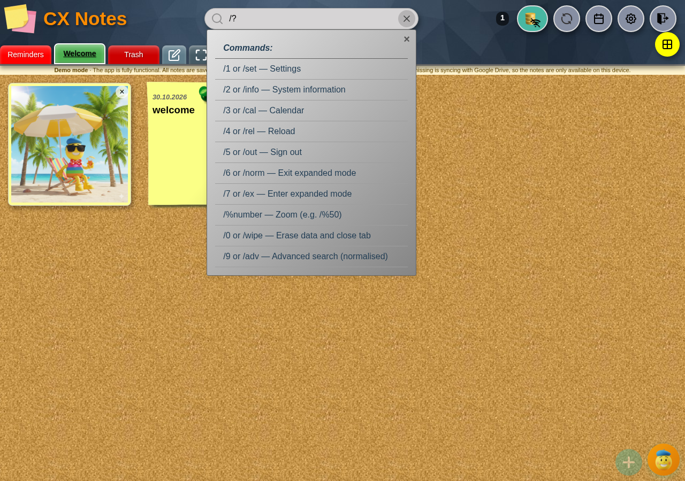

| Command | Action |
|---|---|
| `/1`, `/set`, `/settings` | Settings |
| `/2`, `/info` | System information |
| `/3`, `/cal` | Calendar |
| `/4`, `/rel` | Reload |
| `/5`, `/out` | Sign out |
| `/6`, `/norm` | Leave full screen |
| `/7`, `/ex` | Full screen |
| `/%50` | Zoom 50% |
| `/9`, `/adv` | Advanced (normalised) search — stays on as a mode in the field |
| `/0`, `/wipe` | Deletes all data after a confirmation code |
| `/?`, `/help` | The list of commands |

## 6. Calendar

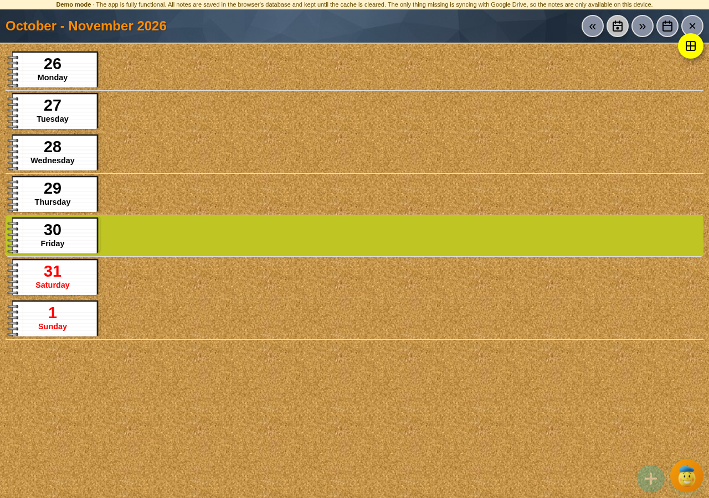

A monthly view with **Today**, arrows for the previous/next month and a **monthly ↔ weekly** switch (the weekly view can also be turned on in Settings). A day with notes carries a dot; clicking a day filters the notes for that date.

With **Write to Google Calendar** enabled, notes that carry a date become events in a separate "CX Notes" calendar, and the bell in the header opens the note of an upcoming event.

## 7. Trash

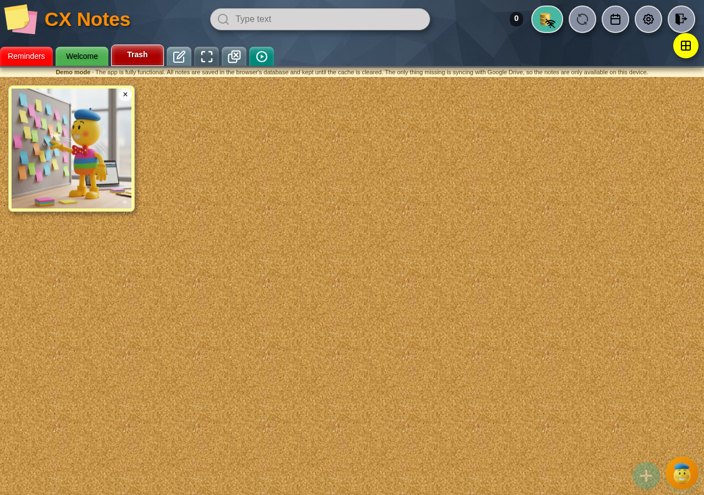

The **Trash** tile shows deleted notes. It has a search field (switched on in Settings), **restore the note**, and a button to **empty the trash** — that also deletes boards that are left only in the trash, but keeps the last board, because the app cannot work without one. Emptying asks with the exact number of notes and the board names.

## 8. Selecting several notes

- **Shift+click** adds a note to the selection, **Ctrl/Cmd+A** selects every visible note, **Escape** clears the selection.
- A bar appears with the count and the actions **Move**, **Delete** (**Delete permanently** in the trash), **Clear selection**.
- After an action you are offered **Undo**.

## 9. Boards: new, edit, reorder

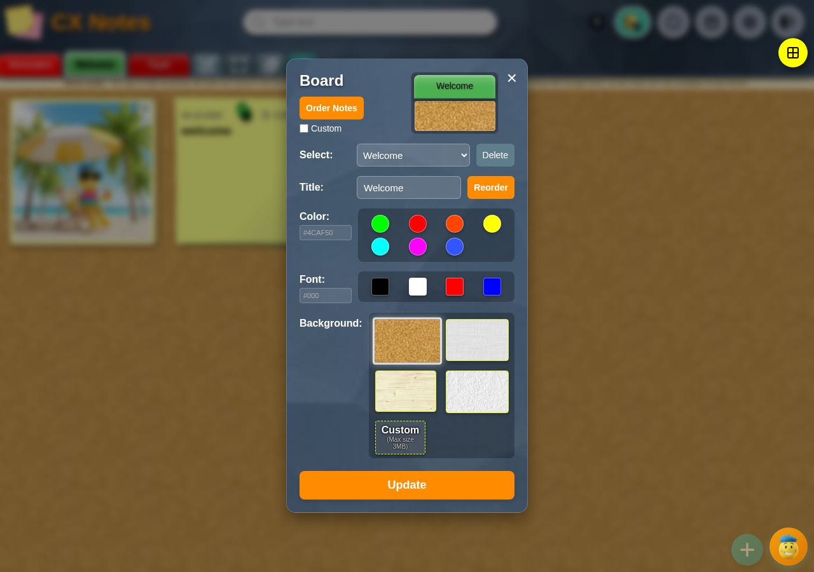

The **✎ Reorder** square opens the board window: pick a board to edit, **Delete**, **Title**, **Colour**, **Font**, **Background** (including a custom picture up to 3 MB), **Reorder**, and a switch for a custom note order per board. An empty title is refused, and so is a duplicate name.

The all-boards menu (`08-boards-menu.png`) shows the tiles in one grid — convenient on a phone, where the bar does not fit.

---

## 10. The "Mode" button — what it really does

This is the least obvious button in the app. Its icon shows the data mode (note, database, drive, folder, archive), and a click does one of three things, in order:

1. **If sync is suspended** (a warning sign is shown): it asks you to sign in again, because sync cannot start without a token. The sign clears only once the token really arrives — a refused sign-in does not leave the app pretending to be online.
2. **If the app is offline**: it probes whether the network is really there (a request to Google and, if that does not go through, to the app's own page). On success it strips `?offline` from the address, shows "Online mode restored" and starts online. On failure it says sync is not possible.
3. **Otherwise**: if you work with **the database only** (Google Drive, local folder and archive all switched off) and the database exists, it starts a sync. In every other case it opens **Settings**, so you can change the data source.

The modes it can show: **Database + Google Drive**, **Database + Local folder**, **Database + Archive**, **Google Drive**, **Database**. The same ones are chosen in Settings → **Data loading** and **Advanced settings**.

## 11. Settings

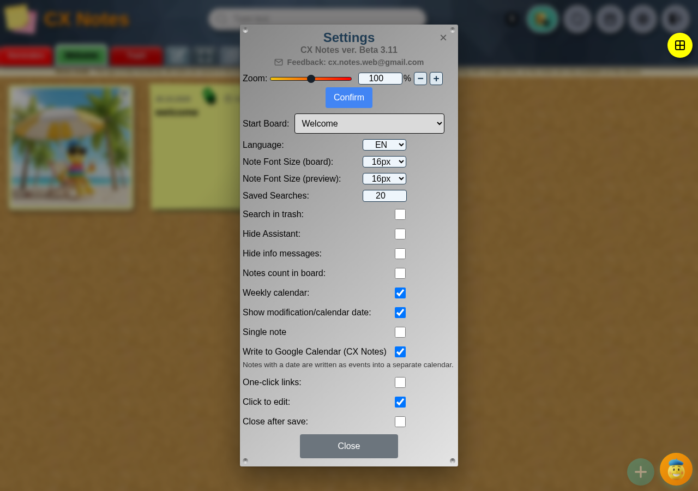

At the top is the version line — **"CX Notes ver. …"**. It is also a hidden button: **Ctrl+click** on it (or a three-second press) shows or hides **Advanced settings**. If the app cannot read the version from the service worker (`CACHE_NAME` in `sw.js`, of the form `cx-notes-b…`), the whole line is hidden.

Rows in the main part:

- **Zoom** — slider, a number in per cent and −/+ steps; **Confirm** applies it. Same as `/%number`.
- **Start board** — which board opens on start.
- **Language** — BG / EN.
- **Note font size (board)** and **Note font size (preview)** — for the card on the board and for the note window.
- **Saved searches** — how many are kept.
- **Search in trash** — adds a search field to the trash as well.
- **Hide assistant** — removes the round assistant button.
- **Hide info messages** — stops the toasts.
- **Notes count in board** — shows the number on the board tile.
- **Weekly calendar** — adds the weekly view.
- **Show modification/calendar date** — which date the card carries.
- **Single note** — opens one note at a time instead of several windows.
- **Write to Google Calendar (CX Notes)** — notes with a date become events; the connection state is shown under the row.
- **One-click links** — opens links with a single tap.
- **Click to edit** — a click on a note goes straight into the editor, without the preview.
- **Close after save** — closes the window after "Save".
- **Auto reminder** — automatic reminders for notes that carry a date.
- **Graphical background (board notes)** and **Graphical background (note)** — a picture instead of a colour.
- **Show additional boards** — tiles for **Reminders**, **All**, **With photos**, **With video**, **With sound**, **Other apps**, **New**.
- **Order notes** — by number, by colour, by creation date, by modification date, by calendar date, alphabetically; plus **in reverse order** and **reminders on top**; a separate order for the system board.
- **Data loading** — **Google Drive** and **Database** with **Create** and **Delete** for the local database.
- **Profile** — several profiles: **+** new, **−** delete the current one, **Load**, **Save**.
- **Advanced settings** (see below).

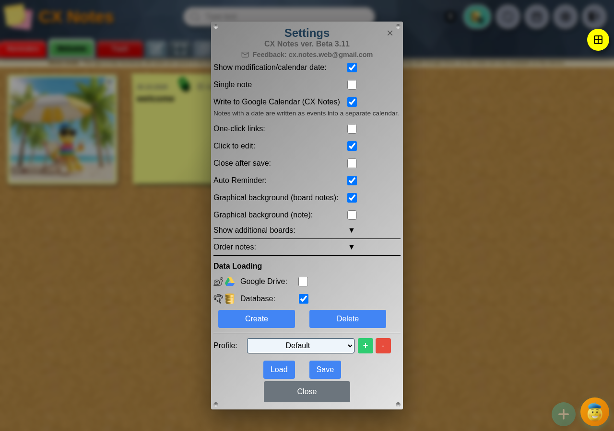

In the advanced part: **Local folder** (with **Update**), **Archive**, folder pickers, **Active folder** (including a new folder in Google Drive), **Delete folder** (with emptying its contents), **Read from GD before edit**, and **Check for empty boards**.

At the bottom:

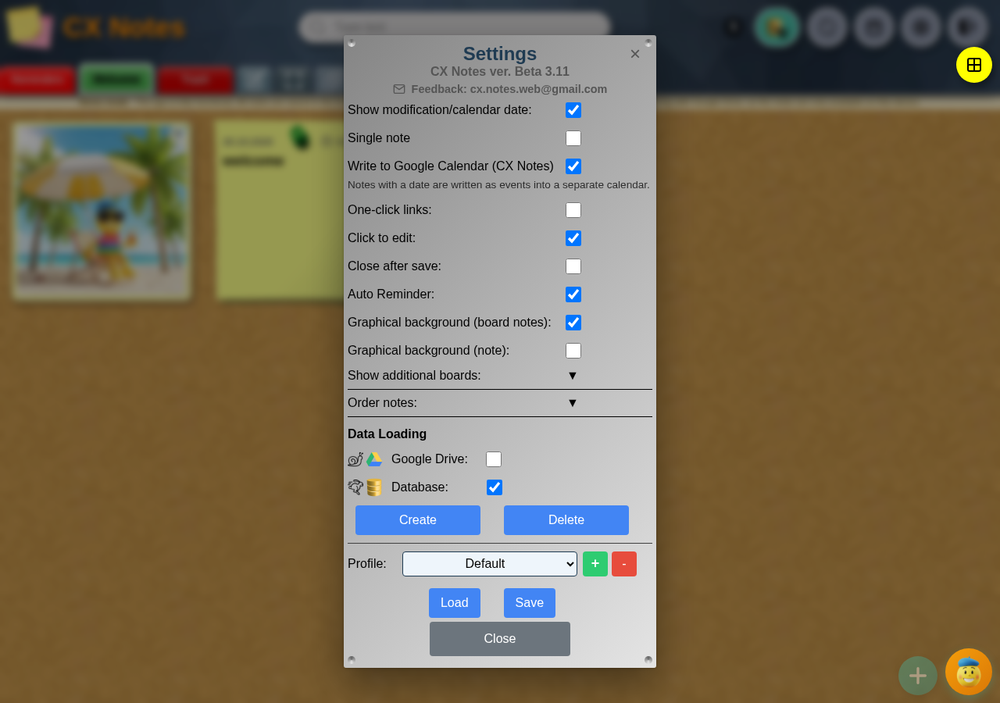

- **Markdown symbols** — your own characters for bold, italic, strike, underline, clear and bullet.
- **Save Archive**, **Save Local folder**, **Sync unsaved changes**, **Save DB to folder** — manual writes per source (with safety checks, e.g. "The folder is not empty").
- **System data** — user, last syncs, load time, source and owner of the database, links to the apps.
- **Close**.

## 12. The assistant (Лепчо)

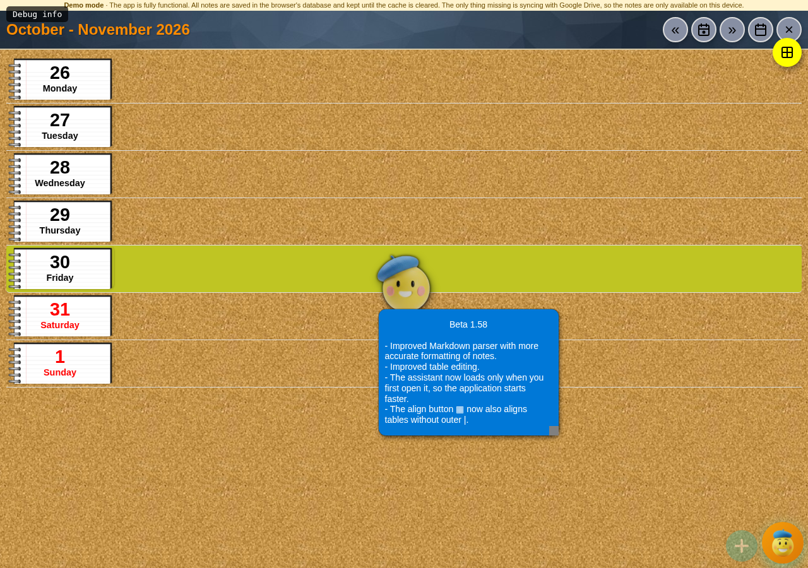

The round button in the bottom right corner opens a chat with the assistant: you ask in words, it answers from the app's knowledge base and can carry out an action (open a setting, change a row, and so on). Its title bar holds **↻** reload the knowledge base, **📑** all questions, **−** minimise; at the bottom, clear and send.

The **▶** square in the board bar restarts the guided tour; during the tour an overlay with instructions appears on the screen. It closes when Settings is opened or the tour is dismissed.

## 13. Full screen

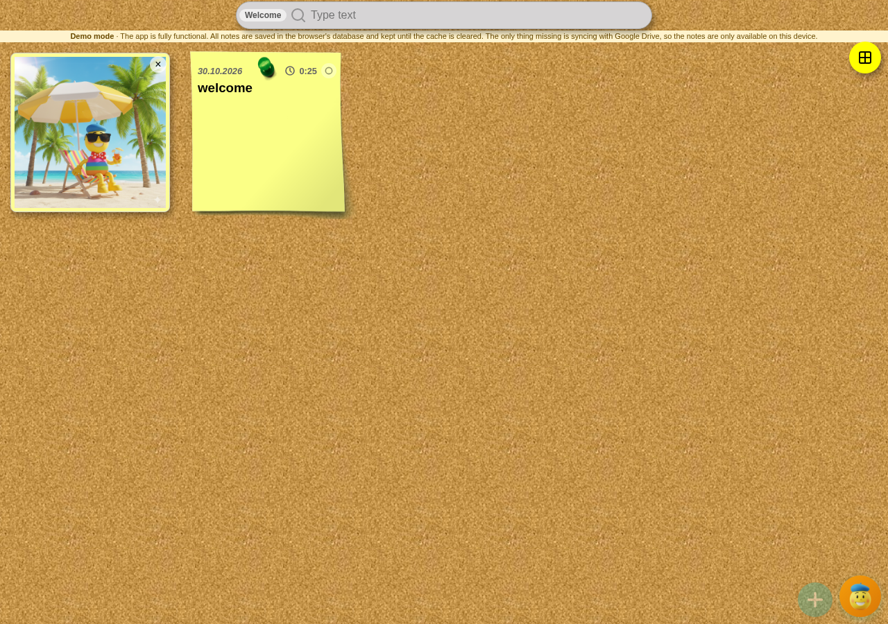

The **⛶** square hides the header and the bar so that only the board is left; the same button brings the header back. The commands `/7` and `/6` do the same.

## 14. On a phone

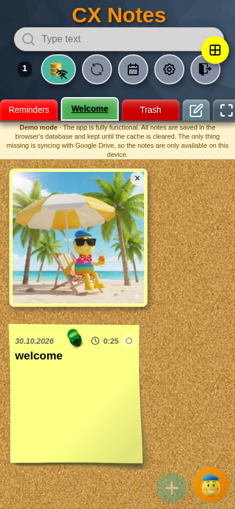

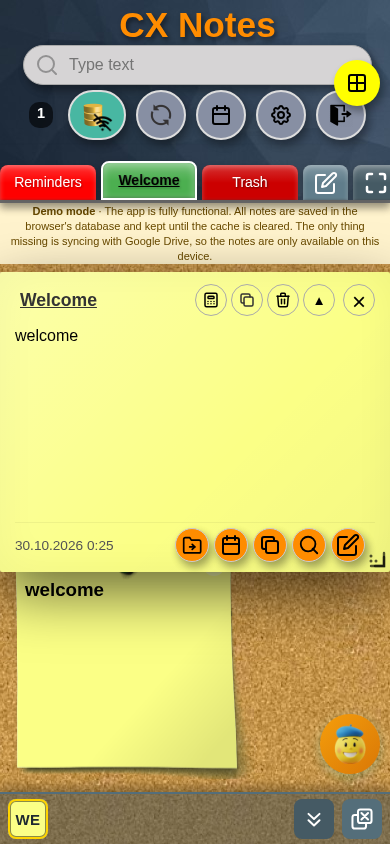

On a narrow screen the header folds, the board bar scrolls sideways, and the note window takes almost the whole screen. A long press with the finger replaces **Ctrl** when resizing a note. The app can be installed on the home screen and run full screen.

## 15. Hidden and little-known functions

- **A click on the empty part of a card's top strip** opens the note's JSON — useful for diagnostics.
- **Ctrl+click on an attachment tile** shows that file's JSON record.
- **Ctrl+click on text inside a note** enters the editor (with the database or sync switched on).
- **Ctrl+click on a board** — the all-boards menu.
- **Ctrl+click on "Reload"** — a forced sync.
- **Ctrl+click or a long press on the version line** — Advanced settings.
- **Ctrl+click on "▦"** — aligns all tables, not just the one under the cursor.
- **The ← → arrows** in the editor: with **Ctrl** (or a long press) they go to the start/end of the line, and again to the start/end of the whole text.
- **Ctrl+A** selects every note in the view; **Escape** clears the selection.
- **Dragging a card** moves the note within the board; **dragging a board** in the reorder window reorders the boards.
- **The handle in the note's bottom right corner** sets the size of new notes; with **Ctrl** it resizes only this one.
- **The commands in the search field** (`/?` for the list).
- **Demo mode** — `?demo=1` in the address; `?demo=0` turns it off.
- **Offline start** — with no network the app offers to work from the data already loaded.

## 16. Demo mode

The demo makes no requests to the internet: the notes are kept in the browser's database until the cache is cleared and are available on that device only. The strip under the header says so, and the way out is the **Sign out** button in the header.

## 17. Known quirks

- **The version line** in Settings appears only when the cache name in `sw.js` is of the form `cx-notes-b…`; with any other name the line is hidden, and the gesture for Advanced settings goes with it (the visible "Advanced settings" section header still opens on its own).
- **"Debug info"** in the top-left corner is a label from the assistant's tour and disappears once the tour ends.

---

*Compiled from `uni/main.js`, `uni/index.html` and `uni/lang/i18n-en.json`; the screenshots come from a real browser in demo mode, on 30 October 2026.*

