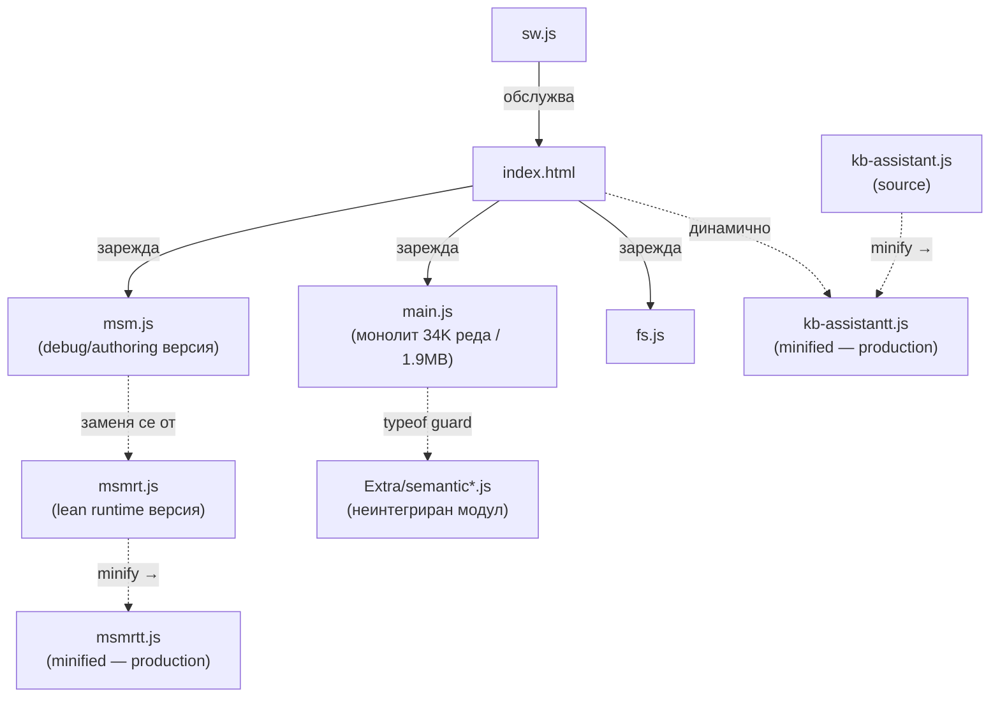

# Доклад за преглед на кода — `uni/`

> [!NOTE]
> Анализирани са всички JS, CSS и HTML файлове в папка `uni/` и `uni/Extra/`.
> Докладът е структуриран по приоритет: 🔴 Висок → 🟠 Среден → 🟡 Нисък → 💡 Козметичен.

---

## Архитектурен преглед



> [!IMPORTANT]
> `msm.js` е debug/authoring версията — **не трябва да се зарежда в production**. Production-ът ползва `msmrt.js` → `msmrtt.js`. Аналогично: source файловете `kb-assistant.js` и `msmrt.js` са само за разработка.

---

## 🔴 Проблеми с висок приоритет

### 1. Дублиране на цели функционални блокове между `msm.js` и `msmrt.js`

Следните функции са **почти 1:1 копия** в двата файла:

| Функция | msm.js | msmrt.js |
|---|---|---|
| `guideDemoBoards()` | ✅ | ✅ копие |
| `guideDemoCreate()` | ✅ | ✅ копие |
| `guideDemoDiscard()` | ✅ | ✅ копие |
| `guideDemoFinish()` | ✅ | ✅ копие |
| `guideDemoReset()` | ✅ | ✅ копие |
| `openGuideNoteTable()` | ✅ | ✅ копие |
| `setGuideSteps()` | ✅ | ✅ копие |
| `showGuideStep()` | ✅ | ✅ копие |
| `removeGuide()` | ✅ | ✅ копие |
| `refreshGuideLanguage()` | ✅ | ✅ копие |
| `playBtn` конструкция (~15 реда JS стилове) | ✅ | ✅ копие |

**Препоръка:** Извлечи общия код в `msm-shared.js` (или `msm-core.js`) и го зареждай и от двата файла. Промяна в логиката в момента трябва да се прилага на две места — класически источник на бъгове.

---

### 2. Дублирана Mouse/Touch логика в `msm.js` (~300 реда)

Три отделни двойки identical event handlers:

| Двойка | Прибл. реда |
|---|---|
| `img.onmousedown` / `img.ontouchstart` (drag на изображение) | ~200 реда |
| `resizeHandle.onmousedown` / `resizeHandle.ontouchstart` | ~40 реда |
| `bubble.onmousedown` / `bubble.ontouchstart` | ~70 реда |

**Препоръка:** Обедини с унифицирана абстракция:
```js
function setupPointerHandlers(el, { onStart, onMove, onEnd }) {
    el.onmousedown = e => onStart({ x: e.clientX, y: e.clientY }, e);
    el.ontouchstart = e => onStart({ x: e.touches[0].clientX, y: e.touches[0].clientY }, e);
    // ...
}
```

---

### 3. `exportStore` vs `exportData` в [`fs.js`](file:///c:/dev/Projects/SeeNotes/uni/fs.js) — 90% дублиране

Двете функции отварят DB, итерират с курсор, прилагат идентична филтрация (`kind === 'directory'`, `keyPath` проверка). Единствената разлика — `exportStore` сваля директно файл, `exportData` връща масив.

**Препоръка:**
```js
async function readAllFromStore(dbName, storeName) { /* обща логика */ }

async function exportStore(dbName, storeName) {
    const data = await readAllFromStore(dbName, storeName);
    downloadAsFile(`${storeName}.bcp`, JSON.stringify(data), 'application/octet-stream');
}

async function exportData(dbName, storeName) {
    return readAllFromStore(dbName, storeName);
}
```

---

## 🟠 Проблеми със среден приоритет

### 4. `formatAnswerHTML` — 3 почти идентични клона в `kb-assistant.js`

В [`kb-assistant.js`](file:///c:/dev/Projects/SeeNotes/uni/kb-assistant.js) методът `formatAnswerHTML` съдържа три клона (`'setting'`, `'ui'`, `'general'`) с почти идентична HTML структура. Разликата е само в `result.question` vs `result.label`.

**Препоръка:** Обедини в обща template функция с параметър за label.

---

### 5. Мъртъв CSS в [`kb-assistant.css`](file:///c:/dev/Projects/SeeNotes/uni/kb-assistant.css) (~50 реда)

| CSS блок | Защо е мъртъв |
|---|---|
| `.kb-related`, `.kb-related-title`, `.kb-related-items`, `.kb-related-item` | `showRelatedSettings = false` завинаги; HTML-ът с тези класове не се генерира |
| `.kb-highlight` + `@keyframes kbPulse` | Никъде не се добавя динамично в JS |
| `.kb-history-item`, `.kb-history-item:hover` | Историята се рендерира с клас `kb-additional-item`, не `kb-history-item` |

**Действие:** Изтрий ~50 реда без никакъв ефект върху UI.

---

### 6. Мъртъв CSS в [`msmstyle.css`](file:///c:/dev/Projects/SeeNotes/uni/msmstyle.css)

| Проблем | Детайл |
|---|---|
| `.guide-next` | Заменен от `.msm-play-btn` с inline стилове; класът не се ползва никъде |
| Дублирана декларация `align-items: center` (редове 6–7) в `.guide-container` | Ред 7 е идентичен с ред 6 — copy-paste грешка |

---

### 7. Потенциален бъг: `position: absolute` vs `position: fixed`

- [`msm.js`](file:///c:/dev/Projects/SeeNotes/uni/msm.js) задава `container.style.position = 'fixed'`
- [`msmrt.js`](file:///c:/dev/Projects/SeeNotes/uni/msmrt.js) задава `container.style.position = 'absolute'`

При scroll страницата, `absolute` позициониране ще измести guide балона. **Трябва проверка дали е умишлено.**

---

### 8. Дублирани CSS правила в `kb-assistant.css`

| Група | Дублирани свойства |
|---|---|
| `.kb-close-btn` и `.kb-reload-btn` | 11 идентични декларации; разлика само в `font-size` |
| `.kb-close-btn:hover` и `.kb-reload-btn:hover` | Идентични (`background: rgba(255,255,255,0.3)`) |
| `.kb-send-btn` и `.kb-clear-btn` | 8 общи свойства |
| `.kb-additional-item` и `.kb-suggestion-item` | Идентична base структура |

**Препоръка:** Извлечи общи класове (напр. `.kb-header-btn`, `.kb-action-btn`).

---

### 9. Inline CSS в `index.html` извън `<head>`

- `<link rel="stylesheet" href="msmstyle.css">` е в `<body>` (ред ~1189) вместо в `<head>` — може да причини FOUC (мигане без стил при зареждане).
- `@keyframes spin` е дефиниран inline в `index.html`, а `@keyframes kbSpin` съществува в CSS файл — дублиране.

---

## 🟡 Проблеми с нисък приоритет

### 10. Неизползвани функции в `kb-assistant.js`

| Функция | Статус |
|---|---|
| `getGuideText(guideData)` | Дефинирана в `KBAssistant`, не се вика от нищо |
| `updateTexts()` в `KBUI` | Дублирана от `updateLanguage()`; не се вика след дефиницията |
| `KBAssistant.getSuggestions()` | Тривиална обвивка около `this.matcher.getSuggestions(count)` — може да се премахне |
| `terminateGuide()` | Вика `window.removeGuide()` + маха pointer img; не се вика от нищо в класа |
| `exportStore()` в `fs.js` | Изглежда заменена от `exportData()`; не се вика от нищо в `fs.js` |

---

### 11. Мъртъв код в `msm.js`

- **Редове 737–738:** `img.onclick = nextStep` се присвоява, след което **веднага** на ред ~760 се презаписва с `img.onclick = wrappedNextStep`. Първото присвояване никога не се изпълнява.
- **Редове 594–595 и 665–666:** Двойно `e.preventDefault()` — copy-paste грешка.
- **`// let isDragging = false; // Moved to top of function`** (ред ~825) — стар коментар без смисъл; трябва да се изтрие.
- **Debug overlay** (`if (!debugOverlay) { ... }`) — debug артефакт, не принадлежи на production файл.

---

### 12. Закоментиран HTML в `index.html`

| Блок | Препоръка |
|---|---|
| AdSense реклама (редове ~100–106) | Изтрий — напълно закоментиран |
| `#feedback_button` | Изтрий — закоментиран HTML |

---

### 13. Дублирана `getCurrentLanguage()` в `kb-assistant.js`

Методът е идентичен в `KBMatcher` и `KBAssistant`:
```js
getCurrentLanguage() { return localStorage.getItem('language') || 'en'; }
```
**Препоръка:** Извлечи като top-level utility функция или статичен метод.

---

## 💡 Козметични проблеми

| Проблем | Файл | Детайл |
|---|---|---|
| `window.showStep = showStep` | `msm.js`, `msmrt.js` | Излишно — function declaration се хойства глобално |
| `module.exports = KBMatcher` | `kb-assistantt.js` | CommonJS export в browser-only файл; не вреди, но е излишен |
| `versionScenarios.map(s => s.id)` без употреба | `kb-assistantt.js` | Debug остатък в `ask()` и `_buildCombinedVersionTour` |
| `this.getCurrentLanguage()` без употреба | `kb-assistantt.js` | Последен ред на `init()` success блок — резултатът не се ползва |
| `window.kbAssistant.getCurrentLanguage()` без употреба | `kb-assistantt.js` | В `showAllQuestions()` |

---

## Папка `Extra/` — статус

> [!WARNING]
> **Нито един файл от `Extra/` не се зарежда от приложението.** Папката е работна/архивна.

| Файл/група | Статус |
|---|---|
| `sw - old.js` | Архив на SW v1.38; текущият е v3.20. Може да се изтрие или премести извън проекта. |
| `semantic.js`, `semantic-worker.js`, `semantic-index.js` | Завършени модули, **готови за интеграция**. `main.js` вече ги „чака" с `typeof scheduleSemanticIndexSync === 'function'`. Само трябва да се добавят в `index.html`. |
| DevTools скриптове (`checkAppDataFolder-*.js`, `cleanup-pinned-at-zero.js`) | Еднократни диагностични инструменти — не са production код. |
| `WHITELIST LOGIC.js` | Изолиран фрагмент от стар auth flow — вероятно вече интегриран в `main.js`. |
| `before-new-auth.zip` | Snapshot архив — може да се премести в git history или да се изтрие. |

---

## Обобщена таблица

| # | Проблем | Файл(ове) | Приоритет | Спестени реди |
|---|---|---|---|---|
| 1 | Дублирани demo/guide функции | msm.js / msmrt.js | 🔴 Висок | ~300+ |
| 2 | Mouse/Touch дублиране | msm.js | 🔴 Висок | ~300 |
| 3 | `exportStore` vs `exportData` | fs.js | 🔴 Висок | ~50 |
| 4 | `formatAnswerHTML` 3 клона | kb-assistant.js | 🟠 Среден | ~40 |
| 5 | Мъртъв CSS | kb-assistant.css | 🟠 Среден | ~50 |
| 6 | Мъртъв CSS | msmstyle.css | 🟠 Среден | ~10 |
| 7 | position: absolute vs fixed | msmrt.js | 🟠 Среден | Потенциален бъг |
| 8 | Дублиран CSS | kb-assistant.css | 🟠 Среден | ~60 |
| 9 | CSS в body / keyframes дублиране | index.html | 🟠 Среден | — |
| 10 | Неизползвани функции | kb-assistant.js, fs.js | 🟡 Нисък | ~60 |
| 11 | Мъртъв код | msm.js | 🟡 Нисък | ~10 |
| 12 | Закоментиран HTML | index.html | 🟡 Нисък | ~15 |
| 13 | Дублирана getCurrentLanguage | kb-assistant.js | 🟡 Нисък | ~5 |
| 14 | Козметични проблеми | различни | 💡 | ~10 |

> [!TIP]
> **Следваща стъпка с висока стойност:** Интегрирай `Extra/semantic*.js` в `index.html` — `main.js` вече е подготвен с `typeof` guard и само чака файловете да се заредят. Това добавя семантично търсене без допълнителни промени в логиката.

какво значи вече е подготвен с typeof guard

В main.js на 3 места има такъв код:

`if (typeof scheduleSemanticIndexSync === 'function') scheduleSemanticIndexSync();`

Това е typeof guard — защитна проверка преди да се опита да извика функцията.

Защо е нужно:
Ако semantic-index.js не е зареден → scheduleSemanticIndexSync не съществува като глобална променлива → без проверката scheduleSemanticIndexSync() щеше да хвърли ReferenceError и да счупи app-а.

С typeof проверката — ако файлът липсва, условието е false, кодът тихо се пропуска, нищо не се чупи.

Аналогия: Като да звъниш на вратата преди да влезеш — ако няма отговор, просто продължаваш нататък вместо да блъскаш вратата.

Практически смисъл: Разработчикът умишлено е написал main.js така, че да работи и с, и без семантичния модул. Достатъчно е да добавиш:

html
<script src="Extra/semantic.js"></script>
<script src="Extra/semantic-index.js"></script>

в index.html преди main.js — и функционалността автоматично се активира.